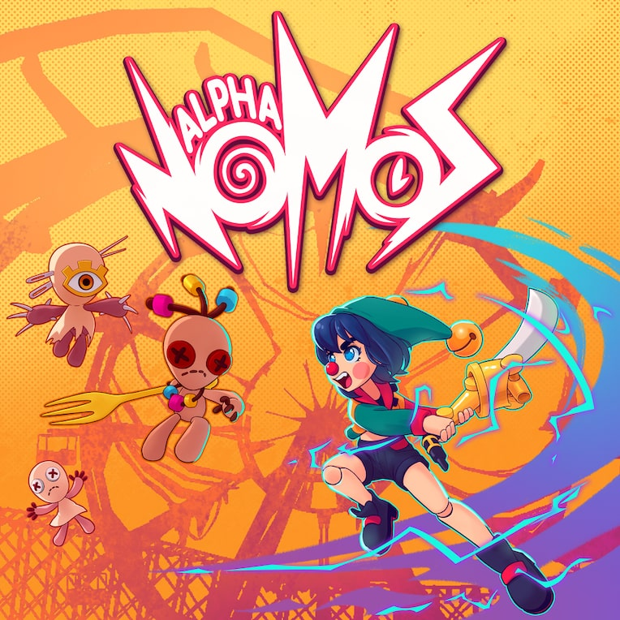

# Alpha Nomos — Trophy Guide (PS5)

> **Heads up:** written two days after launch (2026-10-14), before any community guide existed, so some details are educated guesses, marked `[inferred]` or `[unverified]`.
> Trophy names are visible (minor spoilers). This game has no hidden trophies.

## 1. Game Details

| | |
|---|---|
| **Developer** | RibCage Games |
| **Publisher** | Iphigames IKE (PS5 listing) |
| **Release date** | October 12, 2026 |
| **Price (PS Store, US)** | $17.99 |
| **Trophies (13)** |  1 Platinum  11 Gold  1 Bronze |
| **Time to Platinum** | **~10–15 hours** (estimate; no HowLongToBeat data yet). Reviews describe a short game, but the Platinum needs every unlock collected across many runs. |
| **Platinum difficulty** | **5/10**: reviews describe demanding rhythm timing, plus run-based unlocks. |
| **Does difficulty affect trophies?** | No difficulty settings found `[unverified]`. |
| **Minimum playthroughs** | **1**. Unlocks carry over between runs, so one save is enough `[inferred]`. |
| **Online required?** | No. The game is single-player. |
| **Local multiplayer required?** | No. |

## 2. Roadmap

A rhythm roguelite: you fight through short runs, then return to a village hub where gifts and tokens buy permanent unlocks. The Platinum is mostly "unlock everything" plus one boss, so the plan is to learn the rhythm, beat the boss, spend what you earn in the hub, and finish the random collectibles last. How most unlocks are earned is not documented yet, so the order below is a sensible guess `[inferred]`.

**Step 1 — Learn the loop (first runs)**
Play runs until the rhythm feels natural. Use the metronome option that suits you; reviews say there are several. Salvage any junk piles you see, and put your first powerup up to level 3.
-  A New Home?
-  Wrong Button?
-  Musical Adept

**Step 2 — Beat Dolores**
The boss trophy. About 5% of players had it two days after launch, so expect it to take real practice rather than just time.
-  Arachnophobia

**Step 3 — Spend your haul in the village**
Between runs, visit the village and spend gifts and tokens. Work through weapons, Maestro's combo training and compositions, powerup slots, and the townsfolk. Reviews report that many village visits end empty-handed, so friendship is a slow burn. How the Owl Claw is unlocked is not documented `[unverified]`.
-  Weapon Master
-  Maestro's Favorite
-  Master of The Musical Blade
-  Full Potential
-  A Friendly Face
-  Speading Wings

**Step 4 — Cleanup, then the Platinum**
The random parts go last: pick up every plugin at least once and find the remaining lost scrubs. Keep running; each run is another chance at the missing ones. The Platinum unlocks with the last one.
-  Customization Fiend
-  Friendly Neighbourhood Puppets
-  Alpha Nomos

*Check: 3 + 1 + 6 + 3 = 13 trophies, including the Platinum.* ✅

## 3. Missables

### 3.1 Confirmed missable trophies

**None confirmed.** Permanent unlocks are bought in the village between runs, and runs repeat, so everything looks earnable at any time. Nothing in the list reads as a one-time event. This is a statement about the evidence, not a guarantee.

### 3.2 Not missable, but grind- or luck-dependent

| # | Trophy | Where / when | Why it could slow you down | Recoverable? |
|---|---|---|---|---|
| 7 | A Friendly Face | Village | Gifts and tokens are scarce; many visits end empty-handed `[inferred]` | Yes, keep running `[inferred]` |
| 8 | Friendly Neighbourhood Puppets | Runs | Lost scrubs have to be found; where they appear is not documented `[unverified]` | Yes, runs repeat `[inferred]` |
| 12 | Customization Fiend | Runs | Every plugin must drop at least once, so luck is involved `[inferred]` | Yes, runs repeat `[inferred]` |

### 3.3 Unmissable trophies

- Alpha Nomos — Platinum, automatic
- A New Home? — reaching the village, early story `[inferred]`
- Wrong Button? — junk piles appear in runs and can be salvaged repeatedly `[inferred]`
- Musical Adept — powerup upgrades come naturally with play `[inferred]`
- Arachnophobia — a boss you can retry as often as you like `[inferred]`
- Weapon Master — weapons unlock in the hub `[inferred]`
- Maestro's Favorite — compositions unlock in the hub `[inferred]`
- Master of The Musical Blade — combo challenges are available from Maestro `[inferred]`
- Full Potential — powerup slots unlock in the hub `[inferred]`
- Speading Wings — unlock method not documented `[unverified]`

## 4. Trophy Details

| # | Type | Trophy | Description | Notes |
|---|---|---|---|---|
| 1 |  | Alpha Nomos | Collect all trophies | Unlocks with your last trophy. |
| 2 |  | A New Home? | Arrive at the village | Early; 78.6% of players on PSN (day 2). |
| 3 |  | Musical Adept | Evolve a powerup to level 3 | 18.4% on PSN (day 2). Steam's version says level 2. |
| 4 |  | Weapon Master | Unlock all weapons | 🔁 0.9% on PSN (day 2). You start with the SaxWord; Xynoblades are unlocked later `[inferred]`. |
| 5 |  | Speading Wings | Unlock the Owl Claw | 2.9% on PSN (day 2). Unlock method unknown `[unverified]`. |
| 6 |  | Maestro's Favorite | Unlock all of Maestro's compositions | 🔁 0.0% on PSN (day 2). Maestro is the combo trainer in the hub `[inferred]`. |
| 7 |  | A Friendly Face | Max out your friendship with one of the townsfolk | 🔁 5.8% on PSN (day 2). Needs gifts and tokens; only one villager is required. |
| 8 |  | Friendly Neighbourhood Puppets | Bring all the lost scrubs back to the village | 🔁 1.9% on PSN (day 2). Lost scrubs are found in runs `[inferred]`. |
| 9 |  | Master of The Musical Blade | Complete all musical combo challenges | 🔁 0.0% on PSN (day 2). Combos are bought and unlocked progressively `[inferred]`. |
| 10 |  | Arachnophobia | Defeat Dolores | 4.8% on PSN (day 2). Boss fight. |
| 11 |  | Full Potential | Unlock all powerup slots | 🔁 2.9% on PSN (day 2). Steam's version says "evolve a powerup to level 3". |
| 12 |  | Customization Fiend | Pickup every plugin at least once | 🔁 0.0% on PSN (day 2). Steam's version says "unlock all plugins". |
| 13 |  | Wrong Button? | Salvage a pile of junk | 15.5% on PSN (day 2). |

*Notes key:* 🔁 collection or cumulative. Percentages are the share of PlayStation players who had the trophy two days after launch, so they will drift up.

## About this guide

- **Tags:** `[inferred]` means reasoned from trophy descriptions, previews and reviews. `[unverified]` means little or no information. Untagged facts come from the listed sources.
- **Freshness:** compiled 2026-10-14 from the trophy list, store pages, reviews and previews. Re-check against community guides once they appear.
- **Other platforms:** Steam lists 12 achievements, and three of them are worded differently from the PS trophies (Musical Adept, Full Potential, Customization Fiend). This guide follows the PS trophy text, so be careful with guides written for Steam.
- **Prices:** US PlayStation Store, checked 2026-10-14.
- **Art:** key art from the PlayStation Store; trophy icons are Sony artwork. All trademarks belong to their owners.

## Sources

- [PSNProfiles trophy list](https://psnprofiles.com/trophies/42937-alpha-nomos): trophy names, descriptions, types and PSN rarity
- [PlayStation Store](https://store.playstation.com/en-us/product/HB1359-PPSA38837_00-0739696875022977): price, publisher, release date, art
- [Steam store page](https://store.steampowered.com/app/2529960): developer, single-player, the differing achievement wording
- [Games Asylum review](https://www.gamesasylum.com/2026/10/13/alpha-nomos-review/): village hub, gifts and tokens, run structure, junk
- [PS4 Blog review](https://www.ps4blog.net/2026/10/playstation-5-alpha-nomos-review/): PS5 version, timing difficulty
- [GameSpace demo impressions](https://gamespace.com/all-articles/news/alpha-nomos-first-impressions-from-the-demo/): hub NPCs, starting weapon, combo unlocks
