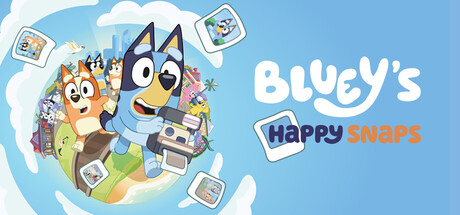

# Bluey's Happy Snaps — Trophy Guide (PS4/PS5)

> **Heads up:** written the day before launch (2026-10-14), before any community guide existed, so some details are educated guesses, marked `[inferred]` or `[unverified]`.
> Trophy names are visible (minor spoilers). The 2 hidden trophies are collapsed: click **reveal** to see them.

## 1. Game Details

| Detail | Info |
|---|---|
| **Developer** | Gameloft Brisbane |
| **Publisher** | Gameloft |
| **Release date** | October 15, 2026 (October 14 in US time zones) |
| **Price (PS Store, US)** | **Standard:** $39.99\* **Deluxe:** $54.99 ($41.24 with PS Plus until launch) |
| **Trophies (21)** |  1 Platinum  7 Gold  9 Silver  4 Bronze  2 hidden (both Gold, collapsed below) |
| **Time to Platinum** | **~5–8 hours** (estimate; no HowLongToBeat data yet). About six locations to scrapbook, plus three collect-everything trophies. |
| **Platinum difficulty** | **1/10**: photos, collecting and activities only. |
| **Does difficulty affect trophies?** | No. |
| **Minimum playthroughs** | **1** (recommended: 1). All trophies are collections or one-off actions. See Roadmap Step 0 before leaving your first location. |
| **Online required?** | No. The game has no online play. |
| **Local multiplayer required?** | No. Optional 2-player co-op exists, but no trophy needs it. |

## 2. Roadmap

One playthrough, no difficulty choices. Work through the locations, play with everything you see, then clean up the collections. It is not yet known whether you can revisit locations, so Step 0 checks that first.

**Step 0 — First-hour check (no trophies)**

After finishing the first location, find out whether you can go back to earlier locations (free roam, a map or level select) and whether a finished scrapbook stays open.
- **If you can revisit:** nothing below is missable, and the order of Steps 2–5 is flexible.
- **If you cannot:** treat Step 3 and Step 5 trophies as **missable per location**. Before leaving a location, finish its scrapbook, try every activity, and look for benches, boxes and hiding spots.

**Step 1 — Camera, scrapbook and dress-up basics (opening area / the Park)**

Take photos, place a sticker, retake one photo, and visit the dress-up box. These are core mechanics you will touch naturally.
-  Chikit!
-  My Name Is Sparkleshot
-  Oooh, Stickers!
-  I Can Do Another One
-  We Were at the Dress-Up Box

**Step 2 — Story progression: discover each location**

Each scrapbook needs about 15 filled entries before the next location opens, so these unlock as you progress. The list order probably matches the game order `[inferred]`.
-  We'll See...
-  Lucky's Dad's Rules!
-  Bye, Uncle Strawberry
-  Are These All for Free?
-  We'll Have to Live in the Forest!

**Step 3 — Activity trophies: grab them on sight, in whichever location they appear**

**⚠️ Possible missables (see Missables).** None is confirmed, but if Step 0 shows you cannot revisit locations, do these before leaving each area. Watch for boxes, benches, hiding spots and drawing pages, and try to fill two scrapbook slots with one shot whenever two requirements look alike.
-  Double Blueys Forever!
-  Am I a Good Drawer?
-  Did That Box Move?
-  Hidden trophy #13 (Gold) 

reveal
<b>Found You!</b> — Take a secret photo. Probably a photo of something concealed in a location; unknown whether it exists in every location or only once `[unverified]`.

-  Hidden trophy #20 (Gold) 

reveal
<b>Ahh, So Relaxing!</b> — Sit on a bench. Probably possible in any location with a bench; try it the first time you see one `[inferred]`.

**Step 4 — Finish the story and unlock every album**

-  Is the Game Over?
-  Home!

**Step 5 — Cleanup: collections, then the Platinum**

Open each location's scrapbook and look for empty slots, uncoloured Play For Real Life pages and unfound pencil case items. If anything is missing, go back and fill it. The Platinum unlocks with the last one.
-  For Real Life!
-  Hooray!
-  Can I Get Dad?
-  I Congratulations Your Ribbon

*Check: 5 + 5 + 5 + 2 + 4 = 21 trophies, including the Platinum.* ✅

## 3. Missables

### 3.1 Confirmed missable trophies

**None confirmed.** No source describes missable content yet, and nothing in the list looks like a one-time story choice or a time-limited event. That is a statement about the evidence, not a guarantee. See 3.2.

### 3.2 Conditional / unverified (in rough order of appearance)

The common risk in this kind of game is "a thing exists only in a location you can no longer return to." Whether locations can be revisited is not documented yet (Step 0 answers it).

| # | Trophy | Where / when | Why it might be missable | Point of no return | Recoverable? |
|---|---|---|---|---|---|
| 15 | Double Blueys Forever! | Early; any scrapbook | One photo has to satisfy two scrapbook slots. If you fill slots one at a time, the chance may pass, although "Replace a photo" suggests you can retake pictures `[inferred]` | Filling a location's scrapbook | Probably, by replacing a photo `[unverified]` |
| 17 | Am I a Good Drawer? | Early, once Play For Real Life pages appear | Pages are earned through photos, so colour one as soon as it unlocks `[inferred]` | Leaving a location, if pages cannot be revisited | Unknown `[unverified]` |
| 19 | Did That Box Move? | Any location | Needs a box and the hide interaction; some boxes may exist in one location only `[unverified]` | Leaving a location | Unknown |
| 13 |  Hidden trophy #13 (Gold) | Any location | 

reveal
<b>Found You!</b> — secret photo. May be a one-time or single-location photo; no source yet `[unverified]`
 | Not stated | Unknown |
| 20 |  Hidden trophy #20 (Gold) | Any location | 

reveal
<b>Ahh, So Relaxing!</b> — sit on a bench. Likely repeatable in any location with a bench `[inferred]`
 | Leaving a location | Unknown |
| 21 | Can I Get Dad? | Unknown | The "Splash Tag" and "Ball Shooter" photos; probably two specific toy-related photos, location unknown `[unverified]` | Not stated | Unknown |
| 12 | Hooray! | Throughout | "All pencil case unlockables." What counts is unknown; if some are tied to locations, completing each scrapbook before leaving is the safe route `[unverified]` | Not stated | Unknown |
| 10 | For Real Life! | Throughout | "All Play For Real Life photos." A collectible set with the same risk `[inferred]` | Not stated | Unknown |

**Rule of thumb until confirmed:** before leaving a location, do everything you can see there: fill its scrapbook, try every toy and activity, sit on benches, hide in boxes and colour any new page.

### 3.3 Unmissable trophies

- I Congratulations Your Ribbon — Platinum, automatic
- Chikit! — first photo, tutorial
- My Name Is Sparkleshot — discover the Park, story progression `[inferred]`
- We'll See... — discover a location, story progression `[inferred]`
- Lucky's Dad's Rules! — discover a location, story progression `[inferred]`
- Bye, Uncle Strawberry — discover a location, story progression `[inferred]`
- Are These All for Free? — discover a location, story progression `[inferred]`
- We'll Have to Live in the Forest! — discover a location, story progression `[inferred]`
- Oooh, Stickers! — core scrapbook mechanic, repeatable `[inferred]`
- I Can Do Another One — core scrapbook mechanic, repeatable `[inferred]`
- We Were at the Dress-Up Box — customization is a standing feature `[inferred]`
- Is the Game Over? — story completion `[inferred]`; the name hints at extra content after the credits, so check for it
- Home! — unlocks as scrapbooks fill, so it follows from progression `[inferred]`

## 4. Trophy Details

| # | Type | Trophy | Description | Notes |
|---|---|---|---|---|
| 1 |  | I Congratulations Your Ribbon | Unlock all other trophies | Unlocks with your last trophy. |
| 2 |  | Chikit! | Take a photo | Tutorial photo. |
| 3 |  | My Name Is Sparkleshot | Discover the Park | Story progression `[inferred]` |
| 4 |  | We'll See... | Discover the Lookout | Story progression `[inferred]` |
| 5 |  | Lucky's Dad's Rules! | Discover the Playspace | Story progression `[inferred]` |
| 6 |  | Bye, Uncle Strawberry | Discover South Bank | Story progression `[inferred]` |
| 7 |  | Are These All for Free? | Discover Hammerbarn | Story progression `[inferred]` |
| 8 |  | We'll Have to Live in the Forest! | Discover camping | Likely a late location `[inferred]` |
| 9 |  | Home! | Unlock all albums | Follows from filling each location's scrapbook `[inferred]` |
| 10 |  | For Real Life! | Collect all the Play For Real Life photos | 🔁 ⚠️ Check every location `[inferred]` |
| 11 |  | Is the Game Over? | The end, or is it? | Story completion; may have post-credits content `[inferred]` |
| 12 |  | Hooray! | Collect all pencil case unlockables | 🔁 ⚠️ Unclear what the pencil case holds `[unverified]` |
| 13 |  |  Hidden trophy #13 | 

Reveal name, description &amp; how to unlock
<b>Found You!</b> — Take a secret photo.  Probably a photo of something concealed in a location. No guide yet `[unverified]`.
 | ⚠️ Possibly missable. Tips in the reveal. |
| 14 |  | I Can Do Another One | Replace a photo | Retake a photo for a filled scrapbook slot. |
| 15 |  | Double Blueys Forever! | Take a photo that satisfies two scrapbook slots | ⚠️ One photo, two requirements; may come naturally `[unverified]` |
| 16 |  | Oooh, Stickers! | Add a sticker to the scrapbook | Stickers come from completed scrapbook entries. |
| 17 |  | Am I a Good Drawer? | Color a Play For Real Life page | ⚠️ Colour any page as soon as one unlocks. |
| 18 |  | We Were at the Dress-Up Box | Customize Bluey or Bingo | Deluxe items are not required `[inferred]` |
| 19 |  | Did That Box Move? | Hide in a box | ⚠️ Look for cardboard boxes in each location. |
| 20 |  |  Hidden trophy #20 | 

Reveal name, description &amp; how to unlock
<b>Ahh, So Relaxing!</b> — Sit on a bench.  Probably available at any bench; try it the first time you see one `[inferred]`.
 | ⚠️ Possibly missable. Tips in the reveal. |
| 21 |  | Can I Get Dad? | Collect the Splash Tag and Ball Shooter photos | 🔁 ⚠️ Probably two specific toy photos `[unverified]` |

*Notes key:* ⚠️ possibly missable (unconfirmed) · 🔁 collection or cumulative ·  hidden trophy (click **reveal**)

## About this guide

- **Tags:** `[inferred]` means reasoned from trophy descriptions, store pages or similar games. `[unverified]` means little or conflicting information. Untagged facts come from the listed sources.
- **Freshness:** compiled 2026-10-14 from the trophy list, store pages and early previews and reviews. Re-check against community guides once they appear.
- **Prices:** US PlayStation Store, checked 2026-10-14. \*The Standard Edition price comes from Gematsu and retail listings, because the PS Store did not show that edition. Deluxe adds the "Here Come the Grannies" mode, extra dress-up items and a digital art album; no trophy mentions them.
- **Art:** key art from the Steam store page; trophy icons are Sony artwork. All trademarks belong to their owners.

## Sources

- [PSNProfiles trophy list](https://psnprofiles.com/trophies/43107-blueys-happy-snaps): trophy names, descriptions, types and hidden flags
- [PlayStation Store (Deluxe Edition)](https://store.playstation.com/en-us/concept/10016903): prices, discount, publisher, release date, "no online play", 1–2 players
- [Steam store page](https://store.steampowered.com/app/3064040): developer, description, co-op, key art
- [Gematsu](https://www.gematsu.com/games/blueys-happy-snaps) and [launch post](https://www.gematsu.com/2026/09/blueys-happy-snaps-launches-october-15): studio, platforms, release date, $39.99 standard price
- [Vooks review (Switch 2)](https://www.vooks.net/blueys-happy-snaps-switch-2-review/): 15 items per scrapbook, locations, co-op, Play For Real Life, difficulty
- [Explosion Network PAX AUS preview](https://explosionnetwork.com/blueys-happy-snaps-pax-aus-2026-preview/): activities and scrapbook mechanics
