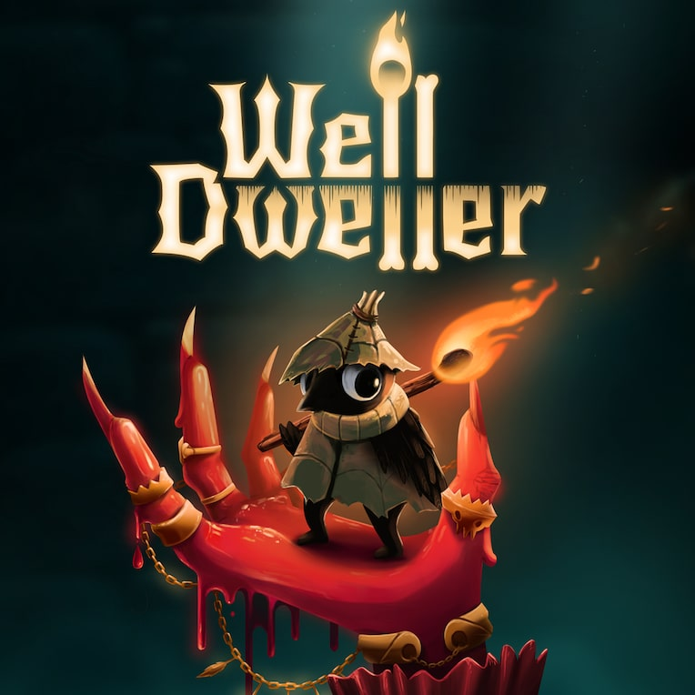

# Well Dweller — Trophy Guide (PS5)

> **Heads up:** compiled three weeks after launch, mostly from community walkthroughs, so a few details are educated guesses, marked `[inferred]` or `[unverified]`.
> Trophy names are visible (minor spoilers). This game has no hidden trophies. Collectible trophies link to video timestamps (▶).

## 1. Game Details

| Detail | Info |
|---|---|
| **Developer** | Kyle Thompson |
| **Publisher** | Top Hat Studios |
| **Release date** | September 22, 2026 |
| **Price (PS Store, US)** | $19.99 (a free demo is also on the store) |
| **Trophies (42)** |  1 Platinum  4 Gold  9 Silver  28 Bronze |
| **Time to Platinum** | **~10–12 hours** (HowLongToBeat completionist: 12 h). The fastest 100% video runs take about 7–10 hours. |
| **Platinum difficulty** | **3/10**: a short metroidvania with collectibles and one skill trophy. 31% of PSN players have the Platinum. |
| **Does difficulty affect trophies?** | No. No trophy mentions difficulty, and assist options reportedly don't affect trophies `[unverified]`. |
| **Minimum playthroughs** | **1**. The save keeps going after the credits, so everything can be finished in one run. |
| **Online required?** | No. The game is single-player. |
| **Local multiplayer required?** | No. |

## 2. Roadmap

One playthrough in two phases: the main story to the Queen, then a short post-credits ending. Nothing is permanently missable, so the easiest plan is to follow the story and pick up every trinket, spirit, page and slot you pass. Later abilities (Hover, Wall Sling, Soar) open earlier areas, so expect a little backtracking; the in-game map marks what is left in rooms you have explored `[inferred]`. The steps below follow the episode order of the Steam walkthrough, so you can watch the matching video for each one (▶).

**Step 1 — Night Garden, The Bog and The Drains (Episodes 1–3)**

First boss, Slingshot, Climb, Tent Travel (fast travel) and Wind Ride. The Workshop and Looter's shop open up, and the first sibling is rescued. Start collecting everything here; the early trinkets, spirits and pages are easy. ▶ [Ep 1](https://www.youtube.com/watch?v=tB6USeyiOcE) · [Ep 2](https://www.youtube.com/watch?v=cG-WbxG8rC0) · [Ep 3](https://www.youtube.com/watch?v=9gYaeEguoVI)
-  Dark Garden
-  Hobby Collector
-  Solo Spirit
-  Snatched Up
-  Once Upon a Time...
-  A Warm File
-  Ten Slots
-  Buggy Business
-  Warming Up
-  Down the Drain
-  In the Workshop
-  Experienced Collector
-  First Purchase
-  Littlest Bird

**Step 2 — Desiccated Castle, Autumn Forest and The Docks (Episodes 4–5)**

A stealth sequence, the Hover ability, the spa, the Forest King and the Water Vessel. ▶ [Ep 4](https://www.youtube.com/watch?v=eFRbuXgQit0) · [Ep 5](https://www.youtube.com/watch?v=T3rjlTGF85c)
-  Hide and Seek
-  Taking a Break
-  The King's Cap
-  Halfway There
-  Fancy Feast
-  Into the Deep

**Step 3 — The Deep, the Dollmaker's House and the Burial Vault (Episodes 6–7)**

Torpedoes, Endless Climb and Wall Sling, then Looter's four parts. **Bouncing Bottles** is the one trophy that needs practice rather than exploration; try it once you have a flaming vessel and a roomy screen, and it is fine to come back to it later. ▶ [Ep 6](https://www.youtube.com/watch?v=s8wbI0ntqOM) · [Ep 7](https://www.youtube.com/watch?v=624YLLMdwIE)
-  Double Trouble
-  On Fire
-  Bouncing Bottles
-  In the Dollmaker's House
-  Stitched Up
-  Fifty Slots
-  Dig Deep

**Step 4 — Lookout Tower, Midnight Drench, Webdrench Inn and the Queen (Episodes 8–9)**

By the end of this step you should have all 32 trinkets and all 20 spirits, so the maximum-upgrade trophy **Fully Stocked** comes last, after the final trinket. Then the Queen. ▶ [Ep 8](https://www.youtube.com/watch?v=DT3PAbNaAFE) · [Ep 9](https://www.youtube.com/watch?v=KbRpxKAheQA)
-  The Tattered Doll
-  Above the Kingdom
-  Pyromaniac
-  Song of the Stars
-  Full Flock
-  Stormy Night
-  Expert Collector
-  Late Night Guest
-  Fully Stocked
-  The First-Born Daughter
-  Sharp and Shiny
-  The End

**Step 5 — After the credits: Soar, Spirit Fragments and the Platinum (Episode 10)**

Continue your save after the credits, learn Soar, follow the map markings to the five Spirit Fragments, then return to the Night Garden to reunite the flock. Any leftover collectibles can be cleaned up now with every ability unlocked. The Platinum unlocks with the last trophy. ▶ [Ep 10](https://www.youtube.com/watch?v=Ez_qcOkga1s) · [▶ Real ending](https://www.youtube.com/watch?v=ilsvmkal4uI&t=2946s)
-  Flying High
-  Together at Last
-  Platinum

*Check: 14 + 6 + 7 + 12 + 3 = 42 trophies, including the Platinum.* ✅

## 3. Missables

### 3.1 Confirmed missable trophies

**None.** Every source agrees that nothing is permanently missable: the game continues after the credits, and later abilities reopen earlier areas.

### 3.2 Easy to overlook (not permanently missable)

| # | Trophy | Where / when | Why it can trip you up | Recoverable? |
|---|---|---|---|---|
| 7 | Bouncing Bottles | Any time after you get a flaming vessel | A skill action with no map marker, so it is easy to forget. The walkthrough author calls it the closest thing to a missable. Sources disagree on whether the Bottle Cap trinket is required, so equip it and the Doll's Head `[unverified]` | Yes, retry any time |
| 6 | Fully Stocked | End of the main story | Needs all 32 trinkets first; a trinket found after upgrading reopens the requirement | Yes |
| 4, 5, 8 | On Fire, Warming Up, Pyromaniac | Throughout | Kill and throw counters; they fill up on their own, but a very stealthy or combat-light run may fall short | Yes, fight more enemies |
| 20 | Expert Collector | Main story | One player reports the last trinket (Paper Clip with String) not appearing after 20/20 spirits `[unverified]` | Unknown; check your trinket list against a guide |
| 9 | Together at Last | After the credits | Needs all 20 ordinary spirits returned `[inferred]`, and the reunion only appears once all five Spirit Fragments are collected | Yes |
| 10 | Flying High | After the credits | Only unlocks after the Queen and the post-credits Soar sequence | Yes, the save continues |

### 3.3 Unmissable trophies

All remaining trophies are story progression, bosses or rescues you cannot skip, or collectibles you can always return for:
- Bosses: Dark Garden, Buggy Business, Down the Drain, Fancy Feast, Song of the Stars, Stormy Night, Dig Deep, Sharp and Shiny, and The End
- Rescues and story events: Snatched Up, A Warm File, Littlest Bird, Hide and Seek, Into the Deep, Double Trouble, In the Dollmaker's House, Stitched Up and Late Night Guest
- Shopping and the Workshop: First Purchase, In the Workshop and The King's Cap
- Optional but always available: Taking a Break (the spa)
- Collections you can always finish later: slots, trinkets, spirits and story pages

## 4. Trophy Details

| # | Type | Trophy | Description | Notes |
|---|---|---|---|---|
| 1 |  | Platinum | Unlock all other trophies | Unlocks once you finish the post-credits ending. |
| 2 |  | Fifty Slots | Collect 50 trinket slots | 🔁 Slot pickups ("Trinket Points") are scattered across the map. [▶ Slots](https://www.youtube.com/watch?v=ilsvmkal4uI&t=80s) · [Ep 7 19:33](https://www.youtube.com/watch?v=624YLLMdwIE&t=1173s) |
| 3 |  | Ten Slots | Collect 10 trinket slots | 🔁 [▶ Slots](https://www.youtube.com/watch?v=ilsvmkal4uI&t=80s) · [Ep 2 15:49](https://www.youtube.com/watch?v=cG-WbxG8rC0&t=949s) |
| 4 |  | On Fire | Kill 500 enemies | 🔁 Fills up on its own while you play. |
| 5 |  | Warming Up | Kill 100 enemies | 🔁 Fills up on its own while you play. |
| 6 |  | Fully Stocked | Upgrade all of your trinkets to the maximum amount | 🔁 ⚠️ Do this last: it needs all 32 trinkets plus enough Workshop tokens, and finding a new trinket afterwards reopens it. [▶ Tokens](https://www.youtube.com/watch?v=ilsvmkal4uI&t=1449s) · [Ep 9 21:15](https://www.youtube.com/watch?v=KbRpxKAheQA&t=1275s) |
| 7 |  | Bouncing Bottles | Juggle a flaming vessel 10 times without it breaking | ⚠️ Skill action with no map marker. Throw a vessel, then hit it upward with the matchstick ten times, in a roomy screen. The Doll's Head (more reach) and Bottle Cap trinkets help `[unverified]`. ▶ [Ep 6 22:47](https://www.youtube.com/watch?v=s8wbI0ntqOM&t=1367s) |
| 8 |  | Pyromaniac | Throw 100 flaming vessels | 🔁 Fills up on its own while you play. |
| 9 |  | Together at Last | Reunite the flock | 🔁 After the credits: collect the five Spirit Fragments, then return to the Night Garden. Needs all 20 ordinary spirits first `[inferred]`. [▶ Real ending](https://www.youtube.com/watch?v=ilsvmkal4uI&t=2946s) · [Ep 10 15:51](https://www.youtube.com/watch?v=Ez_qcOkga1s&t=951s) |
| 10 |  | Flying High | Learn to soar | After the credits: unlocks when you learn Soar. ▶ [Ep 10 2:33](https://www.youtube.com/watch?v=Ez_qcOkga1s&t=153s) |
| 11 |  | Taking a Break | Visit the spa | Optional frog spa in the Midnight Garden, reached after learning Hover `[inferred]`. |
| 12 |  | Above the Kingdom | Collect all pages for "The Lookout Tower" | 🔁 [▶ Pages](https://www.youtube.com/watch?v=ilsvmkal4uI&t=2237s) · [Ep 8 9:00](https://www.youtube.com/watch?v=DT3PAbNaAFE&t=540s) |
| 13 |  | The Tattered Doll | Collect all pages for "The Dollmaker's House" | 🔁 [▶ Pages](https://www.youtube.com/watch?v=ilsvmkal4uI&t=2237s) · [Ep 8 0:23](https://www.youtube.com/watch?v=DT3PAbNaAFE&t=23s) |
| 14 |  | The First-Born Daughter | Collect all pages for "The Witch's Bargain" | 🔁 [▶ Pages](https://www.youtube.com/watch?v=ilsvmkal4uI&t=2237s) · [Ep 9 26:35](https://www.youtube.com/watch?v=KbRpxKAheQA&t=1595s) |
| 15 |  | Once Upon a Time... | Collect a story page | First page is in the Night Garden. ▶ [Ep 1 6:13](https://www.youtube.com/watch?v=tB6USeyiOcE&t=373s) |
| 16 |  | In the Workshop | Upgrade a trinket | The Workshop opens in Gravenvalley; tokens pay for upgrades. [▶ Tokens](https://www.youtube.com/watch?v=ilsvmkal4uI&t=1449s) · [Ep 3 29:04](https://www.youtube.com/watch?v=9gYaeEguoVI&t=1744s) |
| 17 |  | Full Flock | Return 20 spirits | 🔁 Only the 20 ordinary spirits count, not the five Spirit Fragments. [▶ Spirits](https://www.youtube.com/watch?v=ilsvmkal4uI&t=1870s) · [Ep 8 35:42](https://www.youtube.com/watch?v=DT3PAbNaAFE&t=2142s) |
| 18 |  | Halfway There | Return 10 spirits | 🔁 [▶ Spirits](https://www.youtube.com/watch?v=ilsvmkal4uI&t=1870s) · [Ep 5 20:51](https://www.youtube.com/watch?v=T3rjlTGF85c&t=1251s) |
| 19 |  | Solo Spirit | Return a spirit | The first spirits are in the Night Garden. ▶ [Ep 1 23:31](https://www.youtube.com/watch?v=tB6USeyiOcE&t=1411s) |
| 20 |  | Expert Collector | Collect 32 trinkets | 🔁 ⚠️ One player reports the last trinket (Paper Clip with String, granted with Full Flock in the video) never appearing after 20/20 spirits `[unverified]`. [▶ Trinkets](https://www.youtube.com/watch?v=ilsvmkal4uI&t=940s) · [Ep 9 8:09](https://www.youtube.com/watch?v=KbRpxKAheQA&t=489s) |
| 21 |  | Experienced Collector | Collect 10 trinkets | 🔁 [▶ Trinkets](https://www.youtube.com/watch?v=ilsvmkal4uI&t=940s) · [Ep 3 30:23](https://www.youtube.com/watch?v=9gYaeEguoVI&t=1823s) |
| 22 |  | Hobby Collector | Collect a trinket | First trinket is in the Hunter's Cabin. ▶ [Ep 1 15:03](https://www.youtube.com/watch?v=tB6USeyiOcE&t=903s) |
| 23 |  | First Purchase | Buy something from Looter's shop | Buy anything the first time you see the shop. |
| 24 |  | The King's Cap | Buy a festive hat | Autumn Forest, during the Forest King's celebration; costs about 10 currency. |
| 25 |  | The End | Battle the Queen | Ends the main story; the game continues after the credits. |
| 26 |  | Sharp and Shiny | Defeat the Silver Doll | Boss on the way to the Queen's Castle. |
| 27 |  | Late Night Guest | Escape Webdrench Inn | Chase sequence; the Inn Keeper hunts you. |
| 28 |  | Dig Deep | Defeat the Gravedigger | Boss in the Burial Vault. |
| 29 |  | Stitched Up | Put Looter back together again | Find Looter's four parts, using the Golden Gate Key doors. |
| 30 |  | Stormy Night | Defeat the Shrine of the Seven Sons | Boss in the Midnight Drench. |
| 31 |  | In the Dollmaker's House | Collect Magda | Rescue the last sibling after the Dollmaker's Mirror boss. |
| 32 |  | Song of the Stars | Defeat the Starsinger | Boss in the Lookout Tower area. |
| 33 |  | Fancy Feast | Win over the Forest King | Boss in the Autumn Forest. |
| 34 |  | Double Trouble | Collect Thimble and Thistle | Rescue the twins after The Colony boss, in The Deep. |
| 35 |  | Into the Deep | Gain access to a water vessel | The Docks: collect three pearls and beat the Creature From The Deep. |
| 36 |  | Hide and Seek | Evade the Queen | Stealth sequence in the Desiccated Castle: stay out of the searchlight. |
| 37 |  | Littlest Bird | Collect Egbert | Rescue Egbert after the Lida the Terrible boss in Gravenvalley. |
| 38 |  | Down the Drain | Defeat the Lady of the Drains | Boss in The Drains. |
| 39 |  | Buggy Business | Defeat the swarm | Boss in The Bog. |
| 40 |  | A Warm File | Go camping with Ilda | Part of The Bog route. |
| 41 |  | Snatched Up | Meet the Hunter | Early chase sequence near the Hunter's Cabin. |
| 42 |  | Dark Garden | Defeat the Groundskeeper | First boss, in the Night Garden. |

*Notes key:* ⚠️ easy to overlook (not permanently missable) · 🔁 collection or cumulative · ▶ video timestamp (Shinryu Trophy's collectible chapters, or the Gabe and the Goat episode where the trophy unlocks)

## About this guide

- **Tags:** `[inferred]` means reasoned from trophy descriptions or the walkthroughs. `[unverified]` means a single report or conflicting sources. Untagged facts come from the listed sources.
- **Freshness:** compiled 2026-10-15 from the trophy list, store pages, community guides and video walkthroughs. Check for newer community guides on PSNProfiles.
- **Videos:** timestamps come from the creators' own chapter lists. Episode numbers refer to the Gabe and the Goat series; "Slots", "Trinkets", "Tokens", "Spirits", "Pages", "Feathers" and "Real ending" are chapters of the Shinryu Trophy platinum video.
- **Prices:** US PlayStation Store, checked 2026-10-15.
- **Art:** key art from the PlayStation Store; trophy icons are Sony artwork. All trademarks belong to their owners.

## Sources

- [PSNProfiles trophy list](https://psnprofiles.com/trophies/42894-well-dweller): trophy names, descriptions, types and PSN rarity
- [PlayStation Store](https://store.playstation.com/en-us/product/UP5155-PPSA38720_00-WELLDWELLER00000): price, publisher, release date, art
- [Steam store page](https://store.steampowered.com/app/3699590): developer, achievement list and unlock rates
- [Steam walkthrough guide by GabeAndTheGoat](https://steamcommunity.com/sharedfiles/filedetails/?id=3806257027): ten timestamped video episodes with the achievements and collectibles in each, plus the author's missable answer
- [Shinryu Trophy platinum guide (video)](https://www.youtube.com/watch?v=ilsvmkal4uI): collectible chapters (slots, trinkets, tokens, spirits, pages, feathers, real ending)
- [Whisper of the House 100% guide](https://www.whisperofthehouse.com/well-dweller/100-percent-completion) and [true ending guide](https://www.whisperofthehouse.com/well-dweller/true-ending): collectible totals, post-credits route, completion order
- [Gamer Social Club 100% walkthrough](https://gamersocialclub.ca/2026/09/22/well-dweller-100-collectibles-achievement-trophy-walkthrough/): totals, abilities, tricky trophies
- [PlayStationTrophies: Bouncing Bottles](https://www.playstationtrophies.org/game/well-dweller/trophy/bouncing-bottles.html): juggling technique
- [HowLongToBeat](https://howlongtobeat.com/?q=well%20dweller): completion times
- [PoobyGaming beginner tips (video)](https://www.youtube.com/watch?v=eO8QNWIbzD0): assist options
